  

  

  Estudante de Engenharia de Software no UniCEUB 
  Focado em backend com Java, Spring Boot e PostgreSQL.

  
  

### Stack principal

### Testes e ferramentas

### Experiência complementar

### Atividade no GitHub

  

  

